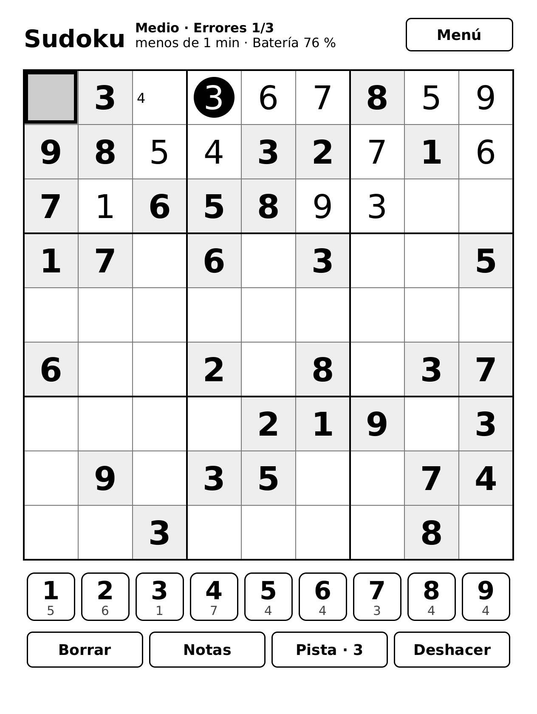
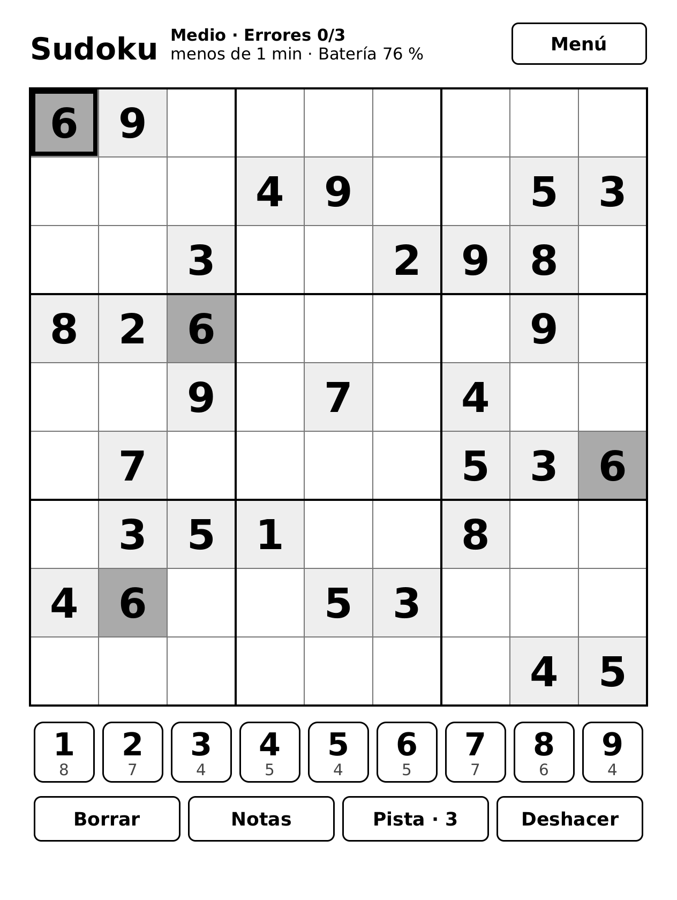
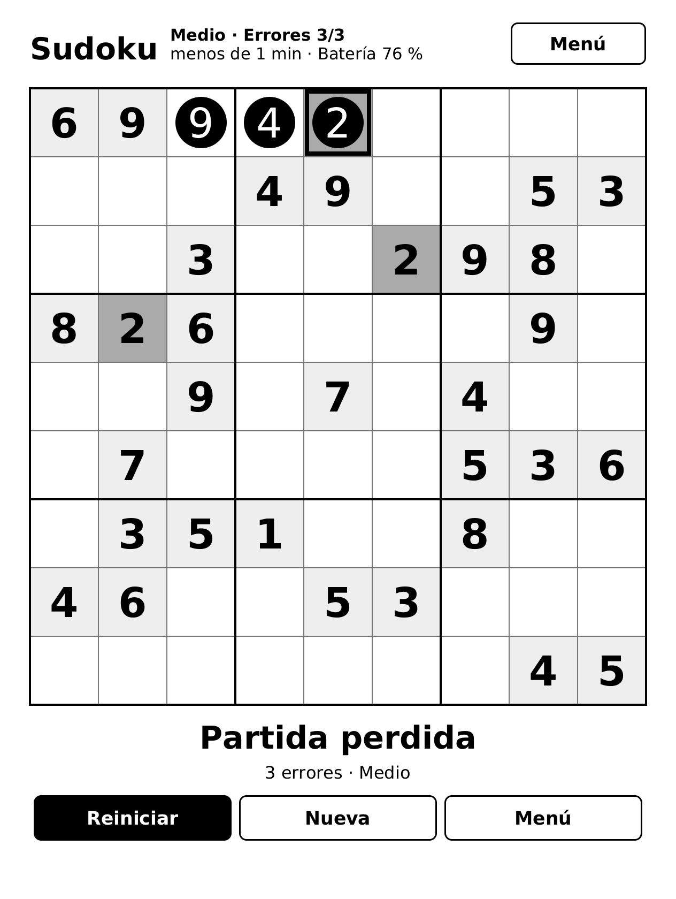

# Sudoku para Kobo

*[English below](#sudoku-for-kobo)*

Un Sudoku para lectores Kobo, en español y en inglés.

  
  
  

**[⬇ Descargar la última versión](../../releases/latest)**: el archivo `sudoku-kobo-….zip`.

## Qué tiene

- Tres niveles. Cada tablero tiene una sola solución.
- Los errores se marcan al momento, y con 3 errores pierdes la partida. Después puedes reiniciar el mismo tablero o empezar uno nuevo.
- 3 pistas por partida.
- Notas a lápiz, deshacer, y debajo de cada número del teclado, cuántos faltan por poner.
- Al elegir una casilla con número, se sombrean todas las que tienen ese mismo número.
- Funciona con el dedo y con el lápiz Kobo Stylus 2.
- Español e inglés. El idioma se cambia desde el menú.

## Qué hace falta

- Un Kobo con pantalla MediaTek:

  | Modelo | Estado |
  |---|---|
  | Kobo Libra Colour | probado |
  | Kobo Clara Colour | sin probar |
  | Kobo Clara BW | sin probar |
  | Kobo Elipsa 2E | sin probar |

  En los modelos sin probar, la primera vez el juego pide calibrar el táctil: toca el centro de cada una de las tres cruces.
- Firmware 4.x. No funciona con 5.x ni con versiones posteriores.
- [NickelMenu](https://pgaskin.net/NickelMenu/) instalado. El juego se abre desde su menú.

## Instalar

1. Descarga el zip y descomprímelo.
2. Conecta el Kobo al ordenador por USB y toca "Conectar" en su pantalla.
3. Dentro de la carpeta `KOBOeReader` del zip hay una carpeta llamada `.adds`. Cópiala en la raíz del Kobo y, si te pregunta, combínala con la que ya existe.
   En Mac, las carpetas que empiezan por punto están ocultas. Pulsa Cmd + Mayúsculas + . (punto) en el Finder para verlas.
4. Expulsa el Kobo y desconéctalo.
5. En el menú de NickelMenu, abre primero "Sudoku (diagnóstico)". Debe decir LISTO.
6. Abre "Sudoku".

Mientras juegas, el lector de Kobo está cerrado. Al salir (con el botón "Salir", el botón de encendido o cerrando la funda), el Kobo se reinicia y en medio minuto vuelve al lector. La partida queda guardada.

Si algo se queda colgado, mantén pulsado el botón de encendido 10 segundos. El Kobo se apaga, y al encenderlo arranca normal.

**Desinstalar:** con el Kobo conectado, borra `.adds/kobosdk` y `.adds/nm/kobosdk`.

Se ofrece tal cual, sin garantía, y lo usas bajo tu responsabilidad. No modifica el sistema del Kobo: todo queda en la carpeta `.adds`.

---

# Sudoku for Kobo

A Sudoku game for Kobo e-readers, in English and Spanish.

**[⬇ Download the latest version](../../releases/latest)**: the `sudoku-kobo-….zip` file.

## Features

- Three levels. Every board has a single solution.
- Mistakes are marked straight away, and 3 mistakes lose the game. You can then restart the same board or start a new one.
- 3 hints per game.
- Pencil notes, undo, and under each number on the keypad, how many are still to be placed.
- When you choose a cell with a number in it, every cell with that same number is shaded.
- Works with your finger and with the Kobo Stylus 2.
- English and Spanish. You change the language from the menu.

## What you need

- A Kobo with a MediaTek screen: Libra Colour (tested), or Clara Colour, Clara BW or Elipsa 2E (not tested). On the untested models, the game asks you to calibrate the touch screen the first time: tap the centre of each of the three crosses.
- Firmware 4.x. It does not work with 5.x or later.
- [NickelMenu](https://pgaskin.net/NickelMenu/) installed. You open the game from its menu.

## Install

1. Download the zip and unzip it.
2. Connect the Kobo to your computer by USB and tap "Connect" on its screen.
3. Inside the `KOBOeReader` folder in the zip there is a folder called `.adds`. Copy it to the root of the Kobo, and if you are asked, merge it with the one that is already there.
   On a Mac, folders whose names start with a dot are hidden. Press Cmd + Shift + . (full stop) in Finder to show them.
4. Eject the Kobo and unplug it.
5. In the NickelMenu menu, first open "Sudoku (diagnóstico)", which is the diagnostics entry. It should say READY.
6. Open "Sudoku".

The Kobo reader is closed while you play. When you quit (with the "Quit" button, the power button or by closing the cover), the Kobo restarts and is back in the reader within half a minute. Your game is saved.

If anything freezes, hold the power button for 10 seconds. The Kobo turns off, and when you turn it on again it starts as normal.

**Uninstall:** with the Kobo connected, delete `.adds/kobosdk` and `.adds/nm/kobosdk`.

This is provided as is, with no warranty, and you use it at your own risk. It does not change the Kobo's system: everything stays in the `.adds` folder.
